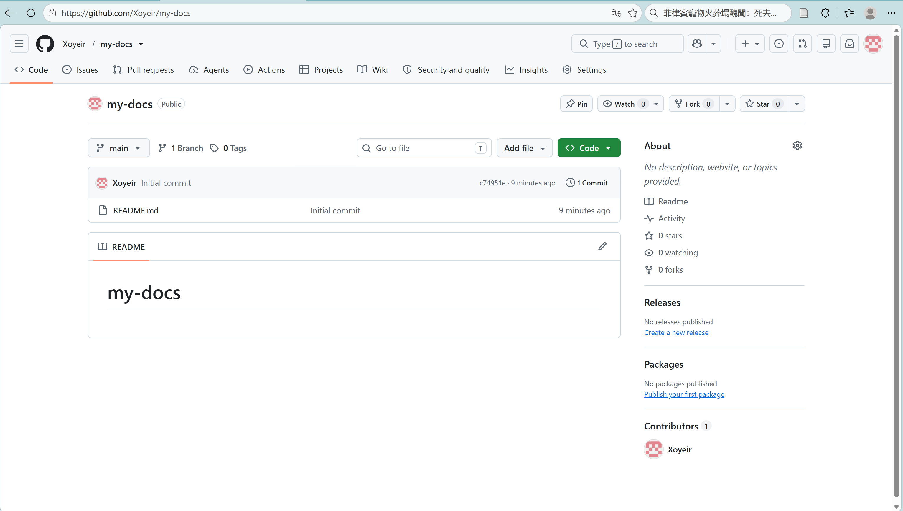
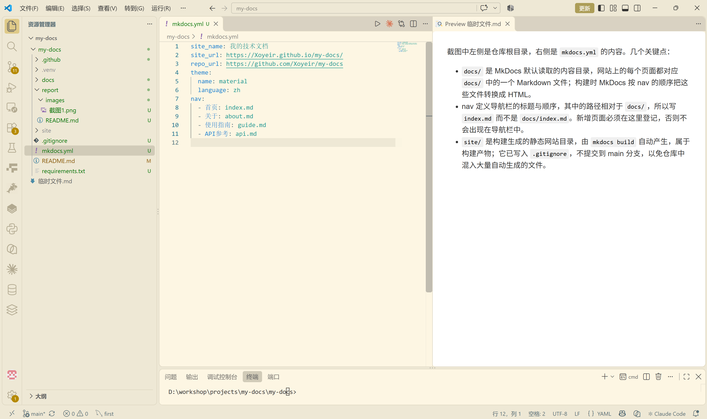
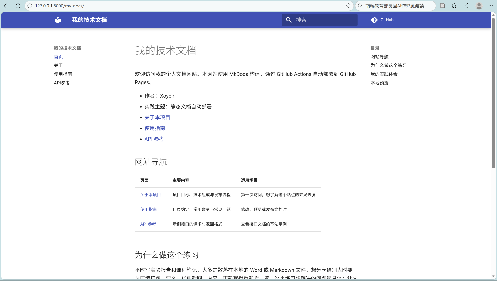
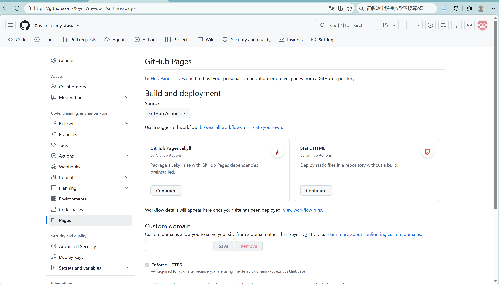
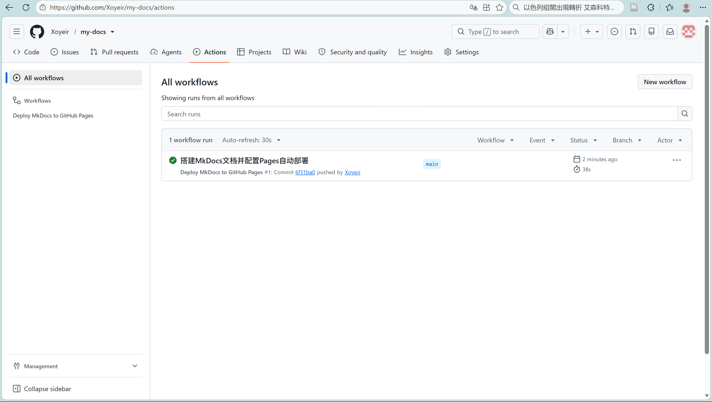
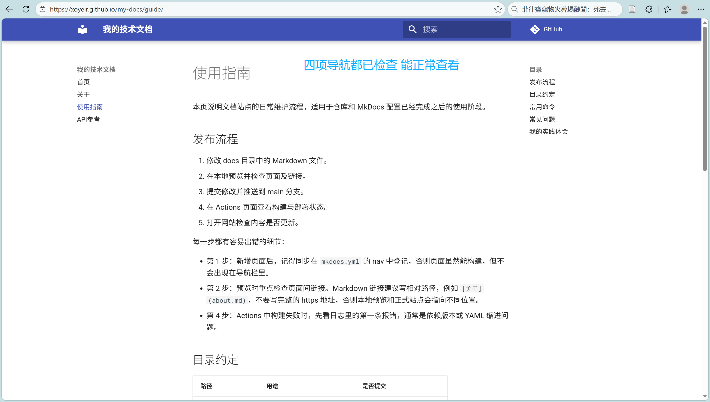
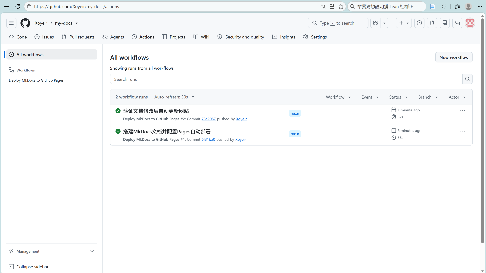
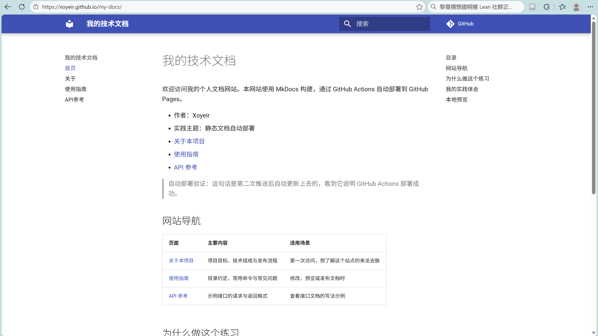

# 实践项目2：个人实验报告

## 1. 基本信息

- GitHub 登录名：Xoyeir
- 个人仓库地址：<https://github.com/Xoyeir/my-docs>
- 最终网站地址：<https://Xoyeir.github.io/my-docs/>

## 2. 实践过程与关键截图

### 2.1 仓库创建

在 GitHub 上新建了公开仓库 `my-docs`，创建时只勾选自动生成 README，默认分支是 `main`。选公开仓库是因为 GitHub Pages 要对外提供访问，老师检查时也不用额外授权。



截图是仓库刚建好的样子，提交记录只有一条 `Initial commit`。后面看到的文档、配置和部署记录，都是这次实践里自己加上去的。

### 2.2 项目结构与 MkDocs 配置

在本地仓库根目录建了 `docs/`、`report/images/` 和 `.github/workflows/`，写了四个页面，另外还有 `mkdocs.yml`、`requirements.txt` 和 `.gitignore`。

`mkdocs.yml` 里主要改了三处：`site_url` 填 `https://Xoyeir.github.io/my-docs/`；主题用 Material，语言设为中文；`nav` 按首页、关于、使用指南、API参考的顺序列出四个文件。



写 nav 时我确认过路径是相对 `docs/` 的，所以写 `index.md`，不能写 `docs/index.md`。`site/` 是构建后才有的目录，已经放进 `.gitignore`，不提交到仓库。

### 2.3 本地构建或预览

在仓库根目录建了 `.venv` 虚拟环境，装好依赖后执行：

```bash
python -m mkdocs build --strict
python -m mkdocs serve
```

构建用了 1.62 秒，没有警告。预览地址是 `http://127.0.0.1:8000/my-docs/`，不是直接访问 8000 根路径，原因写在后面的问题记录里。



截图是本地预览的首页。导航、表格和中文显示都正常，另外三页我也点开看过，页面之间的链接能跳转，代码块也有高亮。

### 2.4 Pages 设置

在仓库的 `Settings → Pages` 里，把 Source 设成了 `GitHub Actions`。



这一步是必须的。工作流里用了官方的 `configure-pages` 和 `deploy-pages`，它们要求 Pages 的发布源是 Actions，而不是某个分支。设置好之后也不用自己建 `gh-pages` 分支。

### 2.5 Actions 首次构建和部署

把本地文件提交为 `6f31ba0`，推送到 main 后，工作流 `Deploy MkDocs to GitHub Pages` 第一次运行，build 和 deploy 两个任务都成功，总用时 38 秒。



运行链接：<https://github.com/Xoyeir/my-docs/actions/runs/45042293578>

截图里能看到提交信息、`main` 分支、绿色对勾和耗时。部署完成后，网站地址 `https://Xoyeir.github.io/my-docs/` 就能打开了。

### 2.6 网站访问与四页导航检查

打开公开网站，把顶部导航的四个页面挨个点了一遍。



截图是“使用指南”页，我在图上标了“四项导航都已检查 能正常查看”。四个页面对应的地址是 `/`、`/about/`、`/guide/`、`/api/`，访问都正常；页面里的表格、代码块和相互之间的链接也都检查过。

### 2.7 第二次推送与自动更新验证

在 `docs/index.md` 里加了一句：

> 自动部署验证：这句话是第二次推送后自动更新上去的，看到它说明 GitHub Actions 部署成功。

提交为 `75a2057` 后推送。这次没有点手动运行，push 之后 Actions 自己出现了第 2 次运行，32 秒后成功。





- 对应提交链接：<https://github.com/Xoyeir/my-docs/commit/75a2057861f86647efc7f5e202fc8da47d33428b>
- 对应 Actions 运行链接：<https://github.com/Xoyeir/my-docs/actions/runs/45042810906>

刷新首页后能看到新增的这句话。为了排除缓存，我访问时在地址后面加了时间戳参数再请求了一次，确认线上内容确实更新了。

## 3. 问题与解决

**问题一：本地预览访问 `/about/` 返回 404。**

启动 `mkdocs serve` 后，我按习惯打开 `http://127.0.0.1:8000/`，结果返回 302；再访问 `/about/` 又变成 404。服务日志是：

```text
WARNING - "GET / HTTP/1.1" code 302
WARNING - "GET /about/ HTTP/1.1" code 404
```

原因是 `mkdocs.yml` 里的 `site_url` 带了 `/my-docs/` 路径，MkDocs 预览时也按这个子路径提供服务。换成 `http://127.0.0.1:8000/my-docs/` 就正常了。配置本身没写错，是预览地址要和 `site_url` 的路径对上。

**问题二：激活虚拟环境时报错。**

一开始在 cmd 里执行 `source .venv/Scripts/activate`，提示 `'source' 不是内部或外部命令`。`source` 是 Git Bash 的命令，cmd 应该用 `.venv\Scripts\activate.bat`。

换到 Git Bash 后又报 `No such file or directory`，因为终端停在外层 `my-docs` 目录，而 `.venv` 实际在里层的 `my-docs/my-docs`。先 `cd my-docs` 再激活就解决了。这个项目目录多套了一层同名文件夹，看路径的时候容易漏掉。

本地构建和两次部署都没有报错，所以我核对的内容是：`mkdocs build --strict` 的完整输出（没有警告）、Actions 里 build 和 deploy 两个任务的日志、还有线上四个页面的访问状态。

## 4. 原理理解

1. **docs/ 和 site/ 各保存什么？为什么不用手工修改 site/？**

`docs/` 保存我写的 Markdown 源文件，是真正需要维护的内容。`site/` 是 `mkdocs build` 根据这些文件生成的 HTML、CSS 和 JS，属于构建产物。每次构建都会重新生成，手工改的内容下次就没了；它也已经写进 `.gitignore`，不进版本库。要改页面只改 `docs/`，然后重新构建。

2. **本次工作流在什么情况下自动运行？**

推送到 `main`，并且改动的文件属于 `docs/`、`mkdocs.yml`、`requirements.txt` 或工作流文件本身时，才会自动运行。另外配置了 `workflow_dispatch`，也可以在 Actions 页面手动点运行。

3. **build 与 deploy 两个任务有什么区别？**

`build` 负责准备和构建：拉取代码、装 Python、配置 Pages、安装依赖、执行构建，最后把 `site/` 上传成 artifact。`deploy` 通过 `needs: build` 等它成功后才开始，拿到 `pages: write` 和 `id-token: write` 权限，把 artifact 发布到 `github-pages` 环境。build 产出，deploy 发布；构建失败就不会部署。

4. **只修改 report/README.md 会触发部署吗？为什么？**

不会。工作流的 `on.push.paths` 只列了 `docs/**`、`mkdocs.yml`、`requirements.txt` 和工作流文件，`report/` 不在其中，所以只改报告不会触发运行，网站内容也不会变。

5. **本次方案为何无需创建 gh-pages 分支？**

因为用的是 GitHub 官方的 Pages 部署方式：`upload-pages-artifact` 把构建结果作为 artifact 上传，`deploy-pages` 直接发布到 Pages。网站不需要从某个分支读取文件，所以不用像旧教程那样把生成结果推到 `gh-pages` 分支。
